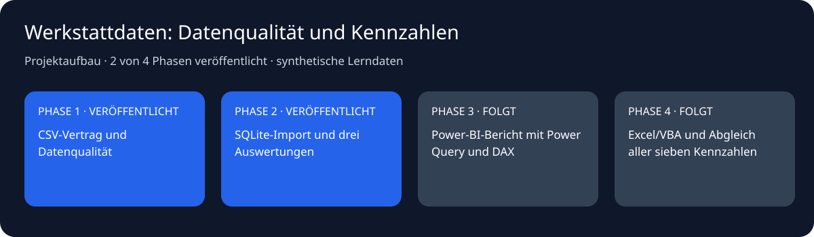

# Werkstattdaten: Datenqualität und Kennzahlen

Bestellungen einer Werkstatt enthalten Dubletten und fehlerhafte Beträge. Auswertungen sollen trotzdem nachvollziehbar und zwischen SQL, Excel und Power BI vergleichbar sein.



**Veröffentlichungsstand: Phase 2/4.** Dieses eigenständige Repository übernimmt zunächst den bereits lokal committeten Stand. Weitere fachliche Phasen werden im Abstand von mindestens vier Stunden veröffentlicht. Die technische Entwicklung und die öffentliche Veröffentlichung haben unterschiedliche echte Zeitpunkte.

## Was hier zu sehen ist

| Schritt | Inhalt | Hier veröffentlicht |
|---|---|---|
| 1 | CSV-Vertrag und Datenqualität | Ja |
| 2 | SQLite-Import und drei Auswertungen | Ja |
| 3 | Power-BI-Bericht mit Power Query und DAX | Folgt |
| 4 | Excel/VBA und Abgleich aller sieben Kennzahlen | Folgt |

## Fachlicher Nutzen

Datenbereinigung, SQL, Kennzahlenabgleich und erklärbare BI-Berichte.

## Lokal starten

Im geklonten Repository ausführen; die benötigte Laufzeit muss installiert sein. Python-Beispiele verwenden 3.12, Node-Beispiele 24 und C# die im Projekt angegebene .NET-Version. Befehle mit uv laden die dort genau bezeichneten Pakete bei Bedarf.

```powershell
python -X utf8 src/arbeitsdatenbank.py
python -X utf8 -m unittest discover -s tests -v
```

Ausführliche technische Befehle: [START.md](START.md). [Öffentlicher Prüfstand](ABNAHME.json) und [Quellphasen](VERLAUF.json) dokumentieren Herkunft und echte Ausführungsdaten. Eine neue Repositorykopie ist kein neuer nativer Desktoplauf.

## Ergebnis des lokal geprüften Schlussstands

12 synthetische Zeilen, 10 gültige Bestellungen, 2 Ablehnungen, 820 EUR; Monatswerte 340 und 480 EUR.

**Dieser Schlussstand ist lokal bereits geprüft, aber noch nicht vollständig in diesem Repository veröffentlicht.** Maßgeblich für den hier verfügbaren Code ist die Phasentabelle oben.

## Grenzen

Synthetische Daten; kein Cloud-BI-Projekt. Desktopdateien benötigen die genannten Produkte.

Eigenes kleines Lernprojekt mit synthetischen Daten, mit KI-Unterstützung entwickelt und geprüft. Keine Aussage über Berufserfahrung, menschliche Arbeitsstunden oder praktische Verwendung weiterer nur geplanter Produkte.

## Entwicklungshistorie

[Entwicklungshistorie](HISTORIE.md): die vorhandenen lokalen Änderungen, ihre ursprünglichen Daten und die spätere GitHub-Übernahme.
